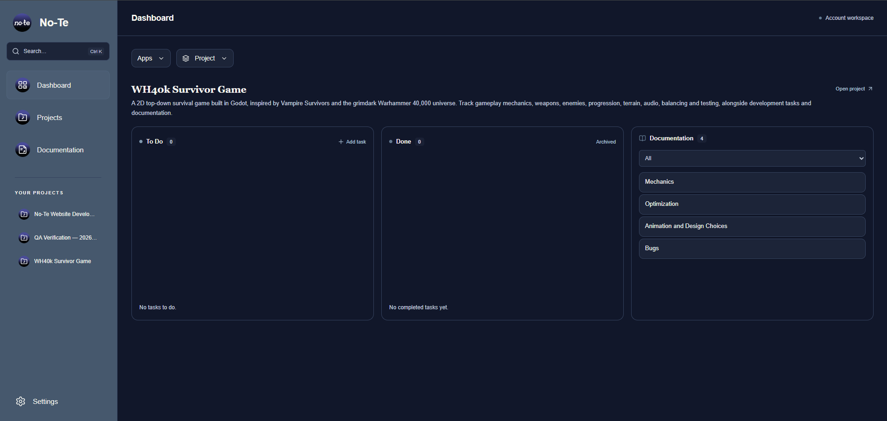

# No-Te

A personal workspace for project tasks, implementation notes and searchable documentation, built with React and Supabase.

**Product design focus:** keeping operational work and its context together. No-Te is a self-initiated, AI-assisted personal tool and a case study in internal-workspace workflows: project orientation, task-to-documentation links, retained completion history and save recovery.

## Start here: product and design

- **[Design case study](docs/design-case-study.md):** problem, user journey, interface walkthrough, decisions, tradeoffs, my role and a proposed usability study.
- **[UX and accessibility review](docs/ux-review.md):** source-based findings, small implemented improvements and a prioritized backlog with acceptance checks.
- **[Verification record](docs/portfolio-verification.md):** checks performed for this portfolio review and their limits.

The current user is me. This repository demonstrates a working product and explainable decisions; it does not claim customer research, team adoption or measured productivity gains. The case study distinguishes implemented behavior from future validation.

**[Live website](https://no-te.org/) · [Source](https://github.com/IvLatkov/no-te) · [Companion game project](https://github.com/IvLatkov/wh40k-survivors-prototype)**

The deployed application requires sign-in. Public demo credentials are not provided; the source and screenshot below are available without an account.



*Dashboard showing the WH40k Survivor Game project.*

## Why I built it

I wanted one place to keep track of what I planned to build, what actually changed, and why. My website and Godot game were generating tasks, bug reports and implementation notes across different tools. No-Te brings those records together while keeping general documentation independent of individual tasks.

This is also a practical learning project: taking an idea through UI design, a working frontend, authentication, database integration, deployment and repeated testing.

## What it does

- **Projects and tasks:** create projects, add tasks, edit details, and move work between To Do and Done.
- **Completion history:** completed tasks stay in Done for seven days, then appear in a searchable archive. Archiving preserves tasks, notes and relationships; tasks can be restored to To Do.
- **Documentation:** a rich-text editor with autosave, folders, tags, search and task links. All / Task-linked / Independent filters keep reference material and implementation records in one list.
- **Dashboard:** choose a project to see its tasks and notes. The selection persists in the same browser separately for each account.
- **External updates:** while the page is visible, background reads check for changes about every 15 seconds and when returning to the tab or reconnecting. They wait during open edit dialogs, saving and unsaved note changes.
- **Authentication and account separation:** Supabase email/password sign-in, session handling and cloud-backed records scoped to the signed-in user.
- **Backups:** export cloud content and inspect a backup without writing it back into the database.
- **Optional local Codex connector:** five scoped MCP tools read projects/tasks, create a task, and save implementation documentation with completion. It is a local Node process, separate from the website.

## My role and use of AI

I define the requirements, decide which workflows belong in the product, direct implementation, test the behavior and prioritize fixes. I use the application for my own projects and compare the implemented result with the original request.

Development is AI-assisted. I use Codex to generate and revise code, propose tests, investigate failures and help review changes.

My work includes reproducing issues, supplying screenshots and error output, checking fixes in the browser, reviewing changes with AI assistance, and managing GitHub, Supabase and Cloudflare setup. Examples include investigating note-editor startup failures, correcting sidebar overlap, verifying persistence after reload, and testing the create-task → linked-documentation → Done workflow end to end.

Decisions and Implementation

| Decision | Reason and implementation |
| --- | --- |
| Keep documentation independent of tasks | Reference guides should survive task completion and can be linked to more than one task. See [documentation relationships](src/data/taskDocumentation.js). |
| Archive instead of delete | Seven-day visibility keeps Done useful without losing the reason for a change. The server supplies completion and archive metadata. See [workflow handling](src/data/taskWorkflow.js). |
| Save documentation before completing work | The connector uses a transactional database operation so a completed task has its implementation record. See [connector service](connector/service.js). |
| Persist only a dashboard preference in browser storage | Remembering an account-scoped project ID does not require caching project contents or credentials in a custom store. See [dashboard preference](src/data/dashboardPreference.js). |
| Refresh quietly and protect drafts | External changes should appear without a full-page reload or interrupting unsaved edits. See [refresh coordinator](src/data/cloudRefresh.js). |

## Technologies

| Area | Tools |
| --- | --- |
| Frontend | React 19, Vite 8, JavaScript, CSS, Lucide icons |
| Rich text | Tiptap 3 / ProseMirror |
| Backend | Supabase Auth, PostgreSQL, row-level security and database functions |
| Hosting | Cloudflare Pages, custom domain `no-te.org`, GitHub |
| Verification | Node test runner, jsdom, isolated PostgreSQL tests through PGlite, Oxlint |
| Optional integration | Model Context Protocol, Node.js, Zod, OS credential storage |

## Run locally

Use Node.js 24 or a version compatible with the lockfile.

```sh
git clone https://github.com/IvLatkov/no-te.git
cd no-te
npm ci
```

Copy `.env.example` to `.env.local`, set `VITE_SUPABASE_URL` and `VITE_SUPABASE_PUBLISHABLE_KEY` for your Supabase project, then run `npm run dev`.

A working workspace needs the matching private database setup; a fresh clone does not create it. Never use secret/service-role keys in the frontend. See [task workflow requirements](docs/task-workflow.md) and the optional [local connector setup](docs/no-te-mcp.md).

## Testing

```sh
npm test
npm run lint
npm run build
```

SQL integration tests require private migration files and skip when those files are absent. Detailed results, dated validation runs and verification limits are in the [verification record](docs/portfolio-verification.md).

## Current progress and limitations

The website is deployed and used as a personal workspace. Core task/documentation workflows and the local connector work; refinement and QA continue.

- There is no public demo account or registration interface.
- Cloud backup restore and automatic import of older browser-only data are not implemented. Legacy browser data remains separate from authenticated cloud records.
- Background synchronization uses polling, not an instant push feed, and pauses while editing or offline.
- Private database setup is not included, so independent deployments need additional backend preparation.
- Broad browser/device coverage, live authorization checks and production monitoring are ongoing work. Existing test results are not a security certification.

See the [workflow guide](docs/task-workflow.md), [MCP guide](docs/no-te-mcp.md) and [historical development notes](docs/development-history.md) for more detail. The historical notes preserve earlier iterations; this README supersedes their older deployment/status statements.

## Ownership and third-party assets

The project currently has no root open-source license. Public visibility should not be read as a blanket grant to reuse all code or assets. App shortcuts use third-party brand icons; their sources and notices are listed in [official app assets](public/apps/SOURCES.md).
