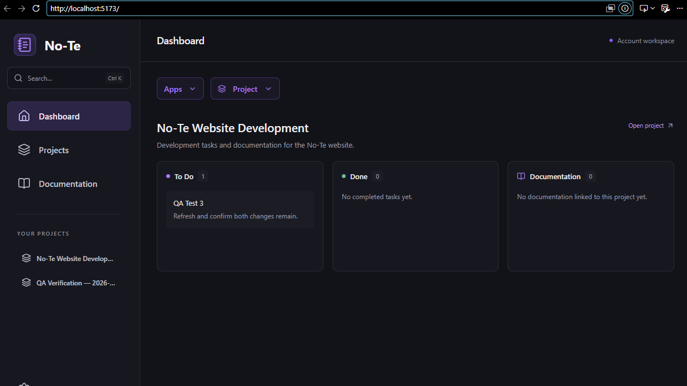

# No-Te: keeping project work and its context together

A self-initiated internal-workspace project by Ivan Latković. Built with React and Supabase, with substantial AI assistance. **Status: implemented personal tool; broader user validation is planned.**

[Live application (sign-in required)](https://no-te.org/) · [Repository overview](../README.md) · [UX review and priorities](ux-review.md) · [Verification record](portfolio-verification.md)

## The problem

My website and Godot game generate tasks, bug reports and implementation notes. When the task list and the explanation of a change live in separate places, returning to unfinished work means reconstructing context.

The product question was: **How can I see what needs doing, open the relevant context, and preserve what changed in one project workspace?**

The current primary user is me. Developers, support staff and operations colleagues handling recurring work are possible future users, not a researched customer segment. No-Te is not an Infobip product and has not been deployed to an enterprise team.

## Scope, role and evidence

| Area | What I can show |
| --- | --- |
| My contribution | Product requirements, workflow choices, prioritization, hands-on checking and directing AI-assisted implementation. |
| Working outcome | A deployed authenticated application with projects, task workflows, documentation and an optional local connector. |
| Design evidence | The implemented interface, source-linked decisions, development history and regression tests. This case study reconstructs the reasoning from that evidence. |
| AI contribution | Codex generated and revised substantial code, helped diagnose bugs, proposed tests and assisted with review and this documentation. |
| Evidence limits | Personal use and automated checks are not customer interviews, observed usability sessions or measured productivity gains. No formal research findings or business-impact numbers are claimed. |

## The core job

When I return to a project, I want to find the next task and its explanation so I can continue without rebuilding the history from memory.

| Moment | User question | Interface response |
| --- | --- | --- |
| Orient | Which project am I working on? | Project selection on the dashboard, project names and account-scoped remembered selection. |
| Act | What needs doing? | To Do tasks, descriptions and explicit movement to Done. |
| Understand | Why was this changed? | Task details and linked implementation documentation. |
| Reuse | Where is the reference guide? | Independent notes, folders, tags, search and link filters. |
| Return later | Where did the completed task go? | Seven-day Done visibility, a searchable archive and restoration to To Do. |

## Interface walkthrough

*Existing repository screenshot from a local development build using QA tasks. It predates later archive/filter controls and the empty-dashboard guidance added in this review. It is an implementation capture, not a wireframe, research result or exact representation of every current screen.*

| Region | Design intent | Question to validate |
| --- | --- | --- |
| Sidebar | Stable access to Dashboard, Projects and Documentation, plus project shortcuts. | Can someone distinguish global documentation from project-scoped documentation? |
| Project workspace | Put pending work, completed work and context near each other. | Does the information density help people resume work or compete for attention? |
| Task states | Use plain To Do / Done labels and explicit actions. | Do users need a Doing state, or does a two-state workflow cover their work? |
| Documentation | Keep reference knowledge accessible after tasks are completed. | Can users explain Task-linked versus Independent without coaching? |

Only the existing QA screenshot is included. A future gallery should capture the current task detail, note editor and narrow-screen navigation using synthetic records after browser verification; those images have not been fabricated.

## Process: what exists and what comes next

1. **Frame a personal problem.** Start from maintaining the website and game, with tasks and implementation context to organize. This is personal experience, not a discovery study.
2. **Build and revise the workflow.** Move from a local workspace toward authenticated cloud records, project summaries, linked documentation and retained completion history. [Development history](development-history.md) links the implementation milestones.
3. **Use AI to explore and implement.** Define requested behavior and constraints, review proposed changes, reproduce failures and compare the result with the requirement. Working code makes ideas testable; it does not establish that the interaction is intuitive to other people.
4. **Check behavior.** Maintain automated checks for editing, persistence, navigation, account separation and recovery. The [verification record](portfolio-verification.md) distinguishes mocked interaction tests from browser and production checks.
5. **Review friction and prioritize.** This portfolio pass found an unguided dashboard without a selection and gaps in keyboard interaction. Small changes are implemented below; broader changes remain in the [UX backlog](ux-review.md).
6. **Validate with other users next.** Run the proposed sessions below before claiming the design works for a team.

## Decisions and tradeoffs

These are explanations of the current design, not claims that each alternative was formally prototyped or A/B tested.

| Decision | Reason | Tradeoff and evidence |
| --- | --- | --- |
| One project summary on the dashboard | Keep one work context visible rather than mixing unrelated task lists. | Switching projects costs an extra action. Remembered selection helps return visits; first visits need guidance. [Dashboard](../src/components/dashboard/Dashboard.jsx), [preference](../src/data/dashboardPreference.js). |
| Two task states | Keep the personal workflow easy to understand and operate. | No explicit work-in-progress or review stage. Test the need before adding states. [Task board](../src/components/TaskBoard.jsx). |
| Independent documentation with task links | A guide can outlive one task, while implementation notes remain discoverable from the work. | Relationships and filters add concepts to learn. [Relationship helpers](../src/data/taskDocumentation.js). |
| Archive completed tasks after seven days | Reduce the active board's history while retaining records and links. | A user may think an automatically archived item disappeared. Countdown labels, archive search and restoration need discovery testing. Seven days is a product rule, not a validated optimum. [Workflow](task-workflow.md). |
| Protect unsaved work before navigation | A failed save should not silently discard the user's writing. | Navigation can be delayed or blocked; recovery language matters. [Authenticated workspace](../src/auth/AuthenticatedWorkspace.jsx), [documentation store](../src/data/cloudDocumentationStore.js). |
| Poll for external changes and pause during edits | Bring connector updates into the workspace while protecting drafts. | Changes are not instant; users need a reliable understanding of freshness. [Refresh coordinator](../src/data/cloudRefresh.js). |
| Shared dark surfaces and accent tokens | Reuse navigation, dialogs, buttons and feedback patterns across a dense workspace. | A consistent palette is not proof of sufficient contrast or accessibility. [Tokens](../src/index.css), [shared dialogs](../src/components/Modal.jsx). |

## Improvements made in this review

- **Dashboard orientation:** when no project is selected, explain how to populate the dashboard. With no projects, offer “Create your first project”; this opens Projects, where the existing creation flow continues. Loading and failure states do not show this guidance.
- **Keyboard dismissal:** Escape closes the Apps disclosure and returns focus to its toggle when focus was inside it. It leaves an active dialog in charge of Escape and preserves focus on unrelated controls.
- **Editor focus:** visible keyboard outlines on the note title and rich-text editing area make the active writing field easier to locate.

These address source-observed usability gaps. They have not yet been evaluated in a rendered browser or with participants. Existing task, authentication and data workflows are preserved.

## Next validation: a small usability study

Recruit three to five people who maintain project tasks and reference notes, including someone who works primarily with a keyboard. Explain that the prototype is being tested, not the participant. Use synthetic data, record only with consent and start with a baseline before testing a revised design.

| Scenario | Observe | Proposed success signal, not a measured result |
| --- | --- | --- |
| Open a project from a fresh dashboard | First action, hesitation, misunderstanding of Project versus Projects. | Participant reaches the intended workspace without coaching. |
| Find a task, open its note, then mark the task Done | Context switches, link discovery, confidence about completion. | Correct task and note found; participant can explain where the history remains. |
| Recover an archived task | Whether “Archived” is noticed and understood. | Participant finds and restores the correct task without assuming data loss. |
| Find an independent guide with filters active | Search behavior, active-filter awareness, ability to clear filters. | Participant finds the guide and explains why it was previously hidden. |
| Edit using only the keyboard; simulate a save failure | Focus visibility, announcements, recovery and retained text. | No keyboard trap; participant understands the failure and retains their draft. |

Record completion, assistance needed, errors, time and participant explanation. Compare baseline and revised behavior without treating a small convenience sample as statistically representative. Prioritize blocked tasks and potential data loss before visual polish.

## Relevance to Internal Tools

No-Te demonstrates an interest in the work behind the interface: navigating operational context, keeping records traceable, preserving drafts and recovering from failures. These are useful internal-tool design questions. The optional connector also creates a concrete place to discuss human review and AI-assisted work.

The next step toward a stronger Product Designer portfolio is evidence from people beyond the creator: research notes, alternatives tested, observed problems and a documented iteration. Team permissions, approvals, audit trails and multi-user collaboration would require new discovery and implementation; the current account-scoped personal tool does not claim them.
